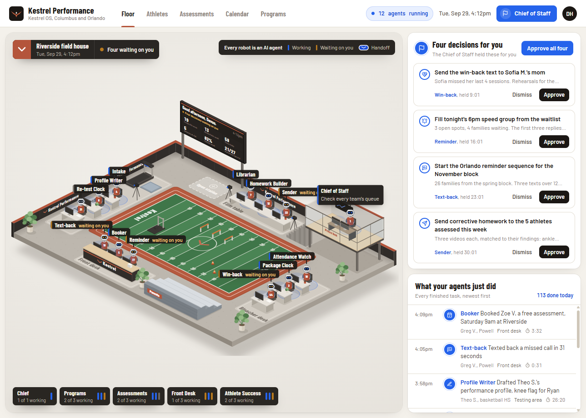
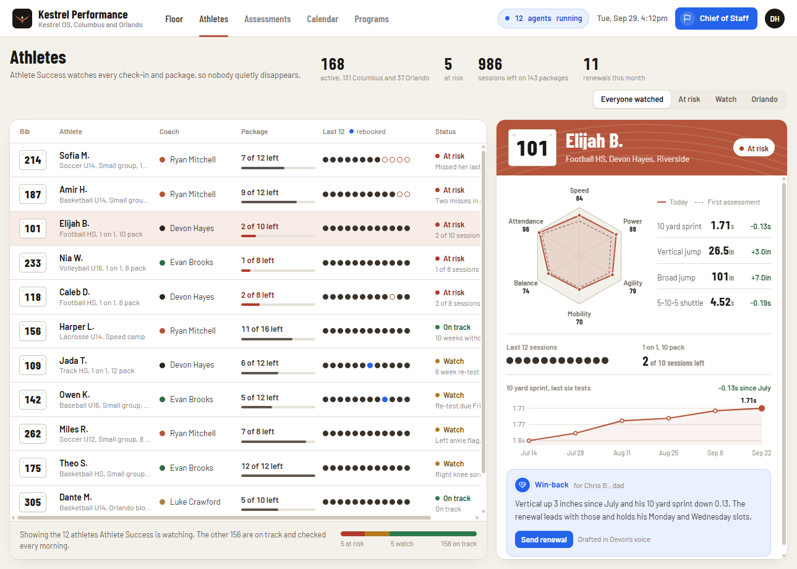
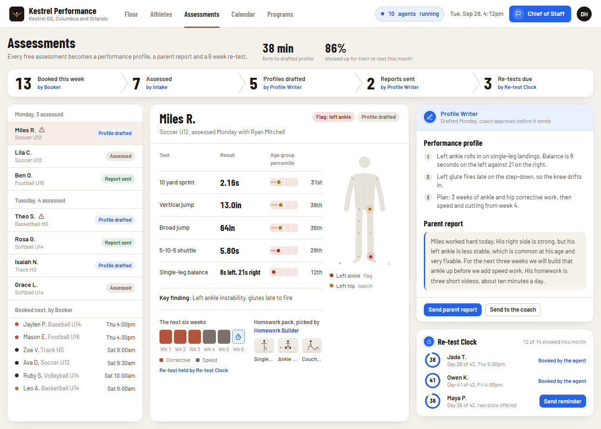
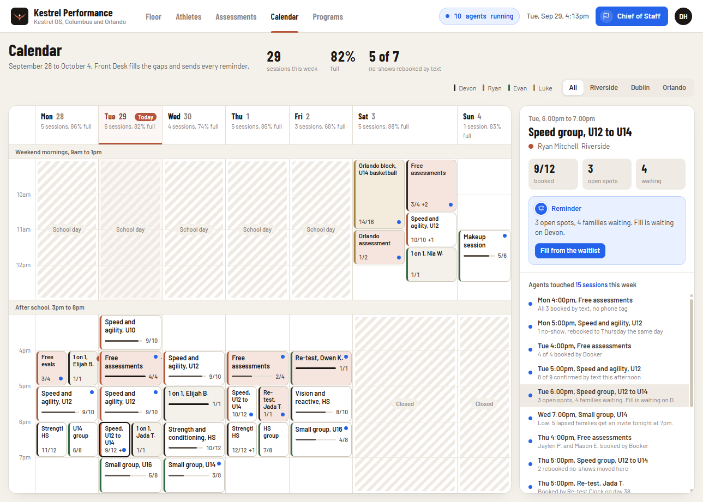
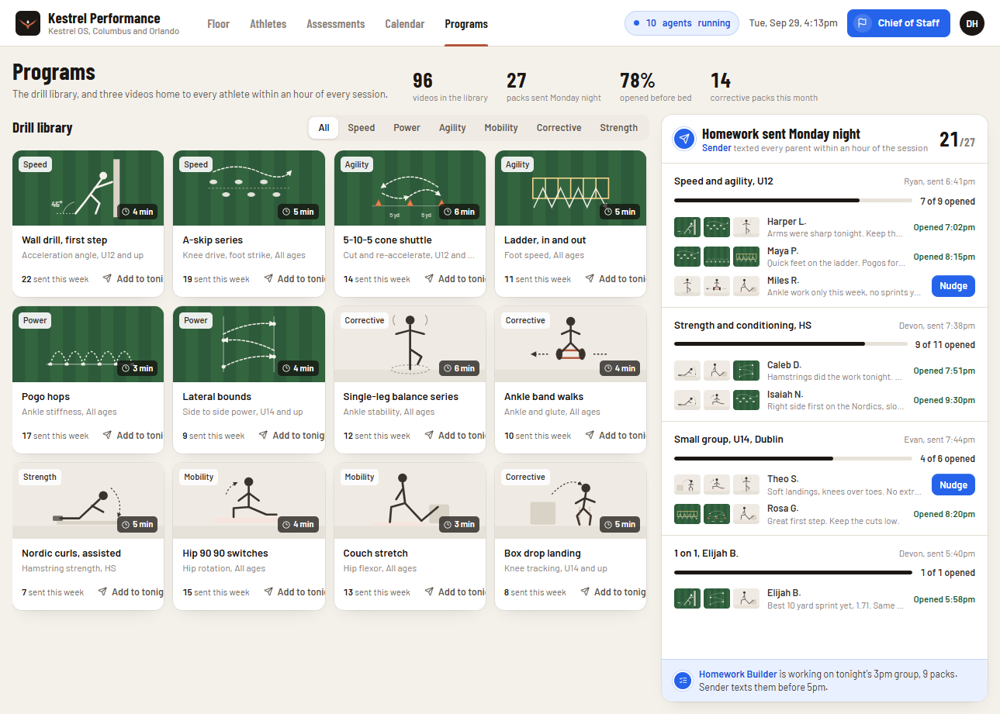

# Kestrel investigation and Diamond Live expansion plan

Investigated October 16, 2026. Target: https://kestrel-os-demo.vercel.app/.

## Recommendation

Evolve Diamond Live into a coaching command center: see what needs attention, inspect the player or practice behind it, review a proposed next step, and track its outcome. Keep the roster, scouting, practice planning, rules library, accounts, and scoring foundation. Use Kestrel's workspace organization and visible handoffs to connect them.

Kestrel's sample business is a sports-performance training operation across Columbus and Orlando. It includes session packages, lead conversion, retention, and parent messaging. A school-team management product is a possible expansion, but this reference alone does not establish demand for it. Start with our existing team-coaching use case; make training-business operations a later product decision.

This document is an implementation proposal. No Diamond Live application behavior or database schema was changed during the investigation. The Notes-app sentence in the request was treated as REA's example prompt; no separate Notes application was supplied or analyzed.

## Installation and verification

- Source checkout: `C:\Users\nhogue\dev\rea`, commit `bf3475867`.
- Installed the checkout's locked dependencies with `npm ci`: 540 packages, zero reported vulnerabilities at installation time.
- Initial source build required the two packaged Windows native artifacts. Restored `manifest.json` and `rea-windows-x64.node` from the official, matching `rea-agents@6.5.0` npm package as the build error instructed. `npm run build:cached` then passed all three tasks. No native compiler or unrelated analysis engine was installed.
- Ran the Codex setup dry run, then applied the authorized scope using `rea-agents@6.5.0 setup --client codex --yes --json`.
- Updated `C:\Users\nhogue\.codex\config.toml`; backup: `C:\Users\nhogue\.codex\config.toml.rea.backup`.
- Installed skill version 42 in `C:\Users\nhogue\.agents\skills\reverse-engineer-anything`.
- Published-package doctor reports Codex healthy, with registration and skill aligned. See [doctor result](rea-doctor.json).
- A separate stdio MCP connection completed initialization and listed **207 tools**, including browser capture and JavaScript analysis. See [MCP verification](rea-mcp-check.json) and [verification script](verify-mcp.mjs).
- The already-running Codex session does not gain newly registered tools. Start a fresh agent session, or restart/reconnect the client, to expose them directly. This investigation used REA's CLI and Orca's embedded browser.
- Native binary engines such as Ghidra, Hopper, IDA, and JADX remain unconfigured. None is required for the website work performed here.
- The source build and published package have different generated catalog identities despite the same version string. Use the published 6.5.0 registration and its matching skill together; do not diagnose that pair using the source build's generated identity.

## Evidence and confidence

Observed means a state or transition captured in the browser. Source-derived means an interpretation of the shipped bundle, with the readable-copy locations below. Proposed means a Diamond Live design or implementation choice.

- [Asset provenance and SHA-256 digests](provenance.json) identifies the exact HTML, JavaScript, and CSS downloaded. Originals in `artifacts/` and the formatting-only `bundle-readable.js` inspection copy are retained locally and excluded from Git. The source locations below refer to that local copy. Browser evidence and our independent implementation are committed.
- [Focused REA summary](rea-focused-summary.json) links to the complete `rea-focused-static.json` Evidence record. Parent ID: `ev_778e01cd75a15eb64f7d32228569a56dff52a8733b18467d3658b179ac62b5d7`.
- REA parsed the selected JavaScript bundle without executing it, visited 126,064 AST nodes, and reported zero parse failures. The first analysis hit its per-file semantic-node ceiling; the focused run raised that ceiling and retained zero budget-omitted nodes or relations.
- Structural coverage remains partial and semantic coverage remains unknown because dynamic relationships cannot all be resolved statically. The increased budget does not turn this into proof of complete behavior.
- A structural literal trace for `d-waitlist` returned no matching graph entity; see [trace Evidence](rea-waitlist-trace.json). REA explicitly says this does not establish feature absence. The calendar explanation below comes from inspecting the literal in the shipped code, not from a successfully recovered structural trace.
- Browser snapshots and the exact inspected PNGs are paired in `evidence/`. Desktop captures used a 1289×921 viewport. The narrow capture used 390×844 with `mobile: false`; it tests responsive layout, not a real phone or touch emulation.
- No private backend, repository, server configuration, authenticated area, delivery provider, or production AI system was available. Static findings and demo UI claims do not establish those systems exist.

## Captured walkthrough

| Step | Captured state or action | Health and finding |
| --- | --- | --- |
| 1 | [Floor](evidence/01-floor.png) | Strong overview: illustrated stations, decision queue, recent activity. Dense and motion-heavy. |
| 2 | [Athletes](evidence/02-athletes.png) | Strong list/detail view: attendance, status, performance history, and next action stay together. Some cells require horizontal scrolling. |
| 3 | [Assessments](evidence/03-assessments.png) | Strong progression from booking to report and re-test; sample injury findings and percentiles lack visible underlying methodology. |
| 4 | [Calendar](evidence/04-calendar.png) | Useful weekly capacity view and selected-session sidebar. Dense time blocks would need an agenda alternative on phones. |
| 5 | [Programs](evidence/05-programs.png) | Useful drill library paired with homework delivery history. The captured thumbnails are illustrations; playable video was not established. |
| 6 | [Chief of Staff opened](evidence/06-chief.png) | Clear assistant entry point and suggested questions; occupies the underlying detail area. |
| 7 | [At-risk question answered](evidence/07-chief-answer.png) | Suggested question returns a readable answer with an attributed agent. Bundle inspection shows keyword/template routing. |
| 8 | [Speed filter selected](evidence/08-program-filter.png) | Working filter reduces the visible library to two speed drills and exposes the selected tab. |
| 9 | [Homework Builder drawer](evidence/09-agent.png) | Strong explanation of current work, previous work, handoffs, and editable instructions. Instructions exist below the screenshot fold and are retained in its DOM snapshot. |
| 10 | [Single decision approved](evidence/10-approved.png) | Decision count drops from four to three. Snapshot caught the sending state; the subsequent screenshot already showed completion. |
| 11 | [Completed decision](evidence/11-completed.png) | Completion appears in the queue and activity history with approval attribution. This is simulated execution. |
| 12 | [Reload](evidence/12-reloaded.png) | Original four decisions and initial counters return. Approval state does not survive reload in the tested session. |
| 13 | [390px viewport](evidence/13-mobile.png) | Cards stack and decision descriptions expand. Header navigation scrolls horizontally; stadium controls and labels are tiny. |
| 14 | [Expansion drawer](evidence/14-expansion.png) | Clearly presents future Reviews, Payments, and Team Sales agents as requests. They are not implemented business integrations demonstrated by this capture. |

### Reference gallery

## How the demo works

| Feature | Evidence | Interpretation and reconstruction consequence |
| --- | --- | --- |
| Navigation | `bundle-readable.js:23032`, `S4` | Selects a view from React state. These five screens do not require separate server-rendered pages in the demo. Our version should support stable links to records and views. |
| Shared UI state | `bundle-readable.js:9664`, `O1`; context accessor `Pe` at 9765 | Holds view, panel, chat, tasks, instructions, notifications, and completed flags in React state. Retain our durable stores instead of copying this state model. |
| Agent activity | Seeded generator `y1` at 8736, scheduler `T1` at 8826, templates preceding `O1` | Simulated timed work and chained templates drive the activity. Counters and animated handoffs are not proof of jobs running on a server. |
| Approval | `jp` at 8895; approve callbacks in `O1` at 9696; decision card `vS` at 18489 | Releases a held simulated task and adds an approval handoff. Production approvals must name exact proposed changes and execute durably. |
| Instructions and one-off completion | `O1` callbacks at 9725 and 9732 | Update in-memory maps and show notifications. “Saved” does not establish persistence beyond this running page. |
| Assistant replies | `kv` at 10522, `wv` at 10533, `Sv` at 10592; templates at 10429 | Lowercases a message, scores keyword matches by keyword length, selects a reply template, and substitutes values. Word-by-word display uses a 38ms timer. This is neither general search nor evidence of an LLM request. |
| Drill filtering | `j4` at 22953 | Exact category filtering over bundled sample records. No full-text drill search was found in this inspected view. |
| Calendar waitlist | `g4` at 22510, `y4` at 22611 | Approval state causes the sample session to display as filled. It does not establish transactional allocation of real places or receipt of family replies. |
| Delivery actions | `markDone` in `O1`, report controls in `KS`, program cards in `w4` | Updates done flags and sample messages. No application messaging service call was found along these inspected paths. |
| Network/storage scope | Bundle text inspection; REA summary limitations; reload capture | The literal `fetch` occurrence is in the module-preload helper. No localStorage/sessionStorage occurrence was found in this bundle. This supports the inspected simulation model but cannot rule out undiscovered external systems. |

The demo's semantic loop is valuable: **input → specialist work → human review → handoff → outcome**. Our existing observation → assessment → suggested drill → approved practice block already implements much of that loop with real coaching records.

## What to preserve and adapt

| Kestrel pattern | Diamond Live foundation | Proposed adaptation |
| --- | --- | --- |
| Floor and review queue | `CoachingWorkspace.jsx`, open observations, next-practice summary | Coach Desk with actionable priorities and activity history; optional baseball field presentation later. |
| Athletes with detail pane | `TeamRoster.jsx`, `ScoutingWorkspace.jsx`, shared player IDs | Player list with observation status, latest assessment, goals, recent work, and an explicit next step. |
| Assessment pipeline | Existing assessment sessions and per-coach ratings | Needs observation → assessed → plan proposed → manager approved → completed → reassess. Keep unobserved ratings blank. |
| Programs and Homework Builder | `practicePlanning.js`, `PracticePlanner.jsx`, sourced drill catalog | Searchable drill library; suggested plans from observed skills; reusable practice templates; player follow-up after coach review. |
| Calendar detail sidebar | Existing events, CSV/ICS import, practice staff assignments | Week/agenda switch, event selection, plan readiness, coach coverage. Add attendance only with actual recorded check-ins. |
| Librarian | `GuidelinesLibrary.jsx`, imported documents, page-linked rule search | Rules assistant grounded in retrieved passages and source pages. Keep scope/year/division visible. |
| Chief of Staff | No general assistant service yet | Read-only coach assistant over authorized team records, with links to evidence. Separate answers from proposed actions. |
| Sender and reminders | No verified message-delivery workflow | Coach-reviewed family communication drafts first; actual delivery and receipts in a later integration. |
| Booking, packages, payments, lead win-back | No corresponding team-coaching foundation | Separate training-business expansion. Avoid adding empty package/retention metrics to our team workspace. |
| Work history | Scoring event records; coaching records and sync recovery | Team activity history for relevant changes, with actor, time, source record, result, and visibility. Keep scoring's event ledger intact. |

Existing behavior is grounded in `README.md`, `CoachingWorkspace.jsx`, `PracticePlanner.jsx`, `practicePlanning.js`, `ScoutingWorkspace.jsx`, `guidelines.js`, and the practice/scouting/storage documentation. Cloud behavior was not reverified against a deployed account in this investigation.

## Proposed product structure

Primary destinations: **Coach Desk, Players, Calendar, Development, Library**. Keep scoring, lineup, film, and family routes reachable as their existing tools. Preserve team/account access and sync-recovery controls in the workspace shell.

Coach Desk should answer three questions: What needs me? What is next? What changed? Start with real inputs: unreviewed observations, assessment gaps, pending practice suggestions, unassigned released blocks, and upcoming events. Display “no data yet” rather than invented agent counts or fabricated completion totals.

Use one selected-record detail surface across Players, Calendar, and Development. Link actions back to their source observation, assessment, event, or guideline passage. Keep the coach's place in the list while opening details.

An illustrated baseball environment can become a recognizable overview after the task flows work. It should be an optional view with an equivalent list of stations, not the sole way to reach a feature. Build original artwork appropriate to Diamond Live; do not ship Kestrel's bundle, brand, athlete examples, or illustrations as our product.

### Visual direction

Observed Kestrel tokens: paper `#f4f1eb`, white cards, ink `#1b1714`, clay `#b4553b`, turf `#2d5a3a`, action blue `#2563eb`; Barlow body and Barlow Condensed display typography; 8px controls, 14px panels, 18px stage rounding. It uses compact rows, restrained borders, and narrow display headings.

Our current Clinch design is dark with lime/lavender accents. The requested UI pivot supports exploring Kestrel's warmer, denser workspace direction. Apply an approved token set consistently through our existing components rather than mixing unrelated palettes page by page. Prototype Coach Desk and one player-detail screen together before rolling the new visual language through every view.

### Improvements to carry into our version

- Keep primary destinations visible at phone widths; provide an agenda and list alternative to dense diagrams and grids.
- Put the player, proposed change, evidence, and expected result in every review item. Let coaches inspect/edit before approving communications or plan changes.
- Treat each approval independently. Bulk approval should require inspecting the affected proposals and skip stale or unauthorized items.
- Use text labels alongside status colors. Provide readable chart values and tabular alternatives for assessment history.
- Validate focus entry/return, Escape handling, tab keyboard navigation, and live status announcements for drawers, chat, and task updates. The captures alone do not establish accessibility compliance.
- Provide reduced-motion behavior and a static overview. Kestrel includes a reduced-motion media-query path in its shipped motion code, but this investigation did not exercise it.
- Keep saving, conflict, failure, retry, and offline states as visible as success. The sample UI's fast completion animation is not an adequate production recovery model.

## Delivery sequence and acceptance criteria

### Phase 1 — Workspace shell and real priorities

Implement the warmer workspace shell and Coach Desk using existing team data. Extract presentation components from the large workspace component without changing persistence contracts. Keep the current account, selected team, permissions, pending-draft protection, importers, and old routes.

Done when a coach can open a priority, inspect its source, navigate to the existing action, complete it, and see the resulting status after reload. Empty teams and viewers have appropriate views. Phone navigation works without requiring horizontal discovery. Existing scoring and coaching tests and production build pass.

### Phase 2 — Player development and library

Add a consistent player detail pane, development history, and drill-library browsing. Reuse the existing assessment aggregation, incomplete-rating rules, recommendation rules, activity creation, and staff assignment logic. Separate rule references, drills, and imported documents inside Library.

Done when an observed skill can lead to a suggested drill, manager-reviewed block, staff assignment, recorded completion, and a follow-up assessment without losing source identity or exposing private rankings to viewers. Exercise manager and assistant roles, concurrent assignment, a stale draft, and failed saves.

### Phase 3 — Durable review queue and history

Introduce proposed actions only where existing workflows need review. Suggested records: `proposals`, `task_runs`, and `activity_entries`, each scoped to team and season. Store source IDs/revisions, proposed payload, reviewer, timestamps, and outcome. Use an idempotency key to prevent duplicate execution. Treat these names as a design proposal, not an applied migration.

Proposed lifecycle: draft → needs review → approved → queued → running → succeeded/failed/cancelled. Approval and execution are different states. Revalidate source revisions and permissions before execution. Keep an execution failure retryable; never mark a task complete just because approval succeeded.

Done when two coaches approving the same proposal create one effect, stale proposals require refresh, unauthorized users cannot read private payloads, and failures remain visible after reload. Apply and verify any additive schema migration before releasing dependent UI.

### Phase 4 — Grounded coach assistant

Start with retrieval over authorized rules, observations, practice plans, and assessments. Return source links, record dates, and explicit missing information. Make team/season and visibility filters part of retrieval, not a cosmetic UI filter. A viewer must not retrieve scouting data through assistant output.

Use deterministic lookup for record navigation and exact filters. Add an LLM only for tasks that benefit from synthesis, behind a server-side boundary with inspectable tool results. The assistant can draft a proposal; an answer must not silently execute an action.

Done when a coach can ask which observed skills need practice, inspect the records used, and open a proposed plan; an unknown answer is labeled unknown; cross-team and coach-only information stays inaccessible to unauthorized roles. Verify provenance and permissions before adding autonomous work.

### Phase 5 — Family follow-through and optional expansion

Build reviewed take-home assignments and family progress summaries from approved coaching material. Add delivery providers, recipient authorization, actual delivery state, and retry/deduplication only when communications are in scope. Show delivery/opened metrics only when backed by recorded provider or app events.

Consider attendance reminders, reassessment schedules, and film-backed evidence next. Evaluate multi-team organizations and sport-specific assessment schemas before school/college expansion. Training packages, payments, lead conversion, and commercial retention belong to a separately selected business scope.

Done when one real team completes the loop from observation to practice to outcome to reviewed family follow-up. Keep that pilot measurable through actual records before broadening operations.

## Search: what was and was not established

No Notes app was supplied. Kestrel's captured Programs view has category filtering, and its chat uses keyword-selected templates. Neither is evidence of Notes-style full-text search.

Diamond Live already has phrase/term guideline search in `guidelines.js:106`, scouting name/number/position filtering in `ScoutingWorkspace.jsx:63`, and simpler division-rule filtering in `CoachingWorkspace.jsx`. Reuse those behaviors. A proposed unified search should group players, observations, events, drills, and documents; preserve original source links; filter by team/season and permission before ranking; support useful empty results; and keep private assessments out of viewer responses. This is proposed follow-up work, not implemented in this investigation.

## Boundaries and remaining decisions

- The broad investigation covers all five main views and selected high-value transitions. It does not claim every button, agent setting, drawer, location filter, or failure state was exercised.
- Real delivery, authentication, billing, live AI, server jobs, and cross-device persistence were not established for Kestrel.
- Touch behavior, screen-reader operation, measured contrast, reduced-motion operation, and full mobile flows require dedicated verification.
- The first build scope should be Coach Desk plus Players/Development, with our current coaching customers as the working assumption. School athletics and training-business operations remain product choices, not implicit requirements from the reference.
- No deployment, production data change, or automated message send was performed.
